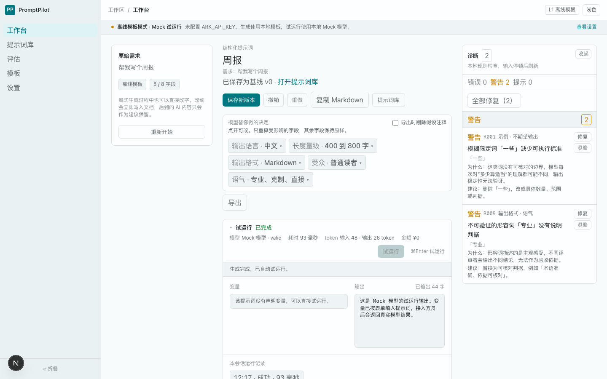
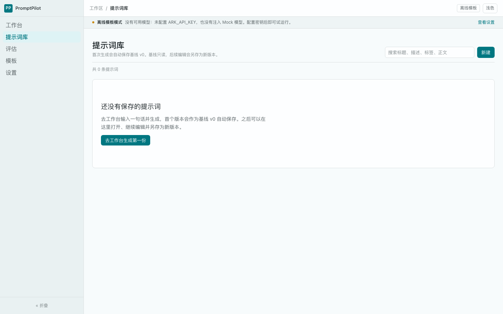
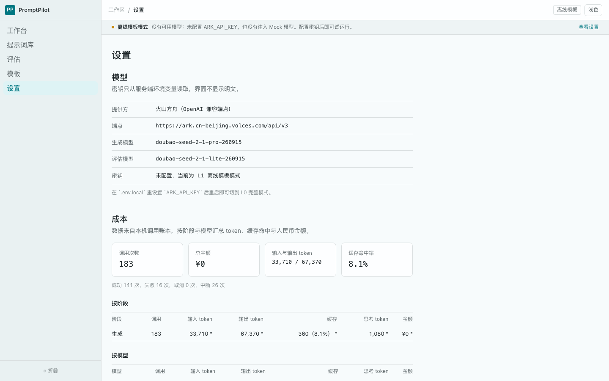

# 界面美化计划

基于 `ui-ux-pro-max` 技能的本地设计库检索，加上对三个页面现状的实测截图与代码统计。

结论先说：**问题不在配色，在结构和层级。** 现在每个元素都是"1px 边框 + 圆角 + 相同底色"的盒子，没有任何东西在视觉上更重要。

---

## 一、诊断

### 证据

| 页面 | 截图 |
|---|---|
| 工作台 |  |
| 提示词库 |  |
| 设置 |  |

### 代码统计

| 指标 | 现状 | 说明 |
|---|---|---|
| SVG 图标文件数 | **0** | 全站纯文字，没有任何图形锚点 |
| `border border-line` 出现次数 | 工作台 19、库 22、字段块 7、诊断 7 | 卡片套卡片 |
| `rounded-panel` | 24 处 | 所有容器同一圆角同一权重 |
| 垂直间距 | `mb-2` 5 处、`mb-4` 4 处、`mb-5` 2 处 | 没有 4/8 网格节奏 |
| 强调色 | `bg-accent` 32、`text-accent` 17 | 只用在按钮，且几乎同权 |
| 内容区最大宽度 | 无 | 1440 下正文拉满，右侧大片空白 |

### 五个具体问题

**1. 没有图形锚点。**
全站零图标。侧栏五个入口是五行同字号同颜色的文字，扫视时找不到落脚点。空态、表头、按钮都靠文字区分。

**2. 卡片汤，没有层级。**
工作台一屏内出现 5 个以上同款边框盒子：需求卡、假设面板、试运行卡、诊断条目、运行记录。它们底色相同、边框相同、圆角相同，用户无法判断哪个是主体。

**3. 排版阶梯没起作用。**
`display 28` / `h2 23` / `h3 19` / `body 14`，但标题与正文同为 `--text`，没有字重、字距、颜色的配合。结果是大字只是"更大的同一种字"，不是标题。

**4. 长页面不收敛。**
设置页与库页内容左贴边、右侧空一大片。设置页的端点 URL 一行拉得很长，表格列宽随手分配。

**5. 按钮没有主次。**
`保存新版本`、`撤销`、`重做`、`复制 Markdown`、`提示词库`、`导出` 六个并列，只有第一个是实心，其余全是同款描边。`导出` 还单独占一行，看起来像漏排。

---

## 二、方向

技能库给出的默认方向是「深色开发者工具 + JetBrains Mono」，并且明确把 `Light mode default` 列进 Avoid。

**这条不采纳。** `DESIGN.md` 定的浅色优先是与文档表格并排办公的场景需求，不是审美偏好。技能自己的规则也写明：检索结果是建议，不能覆盖仓库约定。

采纳它的另外三条：Swiss/Minimal 的网格与留白、明确的字号阶梯、克制的 hover 与过渡。

### 三条原则

1. **用层级代替装饰。** 不加阴影、不加渐变、不加彩色块。靠字号、字重、间距、极浅的底色差把信息分出主次。
2. **一个页面只有一处强调。** 当前操作是实心按钮，其余全部退为描边或纯文字。
3. **图形只做锚点。** 图标用于导航、状态、操作的前缀，不用来占位，不做装饰大图。

---

## 三、令牌层改动

改动集中在 `app/globals.css`，不动业务代码。

### 1. 增加表面层级（替代"全都一样"）

```css
--surface:        oklch(0.997 0.002 210);  /* 现有，卡片底 */
--surface-raised: oklch(1 0 0);            /* 新增，浮起：浮层、选中项 */
--surface-inset:  oklch(0.975 0.004 212);  /* 新增，凹陷：代码块、输入框底 */
--border-subtle:  oklch(0.94 0.005 215);   /* 新增，分隔线，比 border 更轻 */
```

用途区分：
- `border` 用于需要被"看成一个整体"的容器
- `border-subtle` 用于分隔（列表行、表格行、面板内分区）
- 同一个页面里，`border` 容器不超过 3 个

### 2. 字号阶梯收紧

```css
--text-display: 1.875rem;  /* 30，页面标题 */
--text-h2:      1.375rem;  /* 22，区块标题 */
--text-h3:      1.0625rem; /* 17，卡片标题 */
--text-body:    0.875rem;  /* 14，正文，不变 */
--text-label:   0.8125rem; /* 13 */
--text-caption: 0.75rem;   /* 12 */
```

新增两条规则：
- 标题统一 `letter-spacing: -0.011em`，中文标题略收紧视觉更整
- 标题色用 `--text`，正文用 `--text` 但字重 400，说明文字才用 `--text-muted`

### 3. 唯一允许的阴影

```css
--shadow-overlay: 0 8px 24px -12px oklch(0.25 0.01 220 / 0.18);
```

只给三个浮层用：导出菜单、下拉、确认弹层。**卡片一律不加阴影**，这条写进注释防止后来人加回去。

### 4. 动效

```css
--ease-out-quart: cubic-bezier(0.16, 1, 0.3, 1);  /* 已有 */
/* 统一时长：hover 150ms，浮层进出 180ms，不做 300ms 以上的位移 */
```

`prefers-reduced-motion: reduce` 下全部降为 0ms。

---

## 四、组件层改动

### 4.1 新建三个基座组件

**`components/ui/Icon.tsx`**
内联 SVG，Lucide 风格，`stroke-width: 1.5`，`currentColor`。不装依赖，手写 16 个图标：

```
工作台(pen-line) 库(library) 评估(gauge) 模板(layout) 设置(sliders)
撤销(undo) 重做(redo) 复制(clipboard) 导出(download) 保存(bookmark)
诊断(alert) 修复(wand) 忽略(eye-off) 试运行(play) 停止(stop) 关闭(x) 折叠(panel-left)
```

**`components/ui/Button.tsx`**
四级：`primary`（实心）/ `secondary`（描边）/ `ghost`（无边框，hover 有底）/ `quiet`（纯文字）。两档尺寸 `sm 28px` / `md 32px`。强制 `type` 与 `aria-label`（图标按钮）。

**`components/ui/Section.tsx`**
统一区块容器：可选标题、副标题、右侧操作槽、`divide-y` 分隔。用来消灭"卡片套卡片"。

### 4.2 各页面

**侧栏**
- 每个入口加 16px 图标，与文字间距 10px
- 激活态：`bg-accent-subtle` + 图标与文字转 `text-accent`，不加左侧竖条（`DESIGN.md` 明令禁止）
- 折叠按钮改为图标按钮，底部对齐

**顶栏**
- 高度 48 保持，但把面包屑的字号降到 `caption`，当前页用 `label` + medium
- 右侧状态徽标与主题切换之间加一条 1px 分隔线

**工作台（改动最大）**
1. 需求卡去掉外边框，改为 `surface-inset` 底的输入区，聚焦时升为 `surface` + `border-strong`，只保留一处描边
2. 结构化文档去掉外层卡片，改为文档流：标题 30px，`已保存为基线 v0` 改为 `chip` 样式的一行元信息
3. 工具栏分三组，组间用 12px 间距 + 1px 分隔：主操作（保存）、历史（撤销/重做）、输出（复制/导出/库）
4. `导出` 从独立行收进工具栏，`复制 Markdown` 与它合并为「复制 / 导出」两个入口，减少并列
5. 假设 chip 面板去掉外框，改为文档下方的一行 chips + 一行说明
6. 试运行卡：表头压到 `caption`，用时/token/金额横向对齐用 `tnum`，输出区用 `surface-inset` 底
7. 诊断面板：组标题用 `caption` + 字重 medium，条目标题与说明分两级，`修复`/`忽略` 收为图标按钮 hover 才显形

**提示词库**
- 顶部标题与搜索/新建按钮同一行，按钮改 `primary sm`
- 列表项：左侧标题 + 版本数，右侧更新时间，行间 `border-subtle`，hover 整行 `bg-bg-sunken`
- 空态：改为居中，配一个 48px 线性图标 + 标题 + 说明 + 主按钮，不再是左上角一段文字套大框
- 内容区 `max-w-[1120px]` 居中

**设置**
- 内容区 `max-w-[880px]`，左对齐而非居中，避免长行
- 配置项改为两列表格：`label` 列 120px 固定，值列等宽，长 URL 允许换行
- 统计卡：数字用 `display` 字号 + `tnum`，标签 `caption`；四卡之间只留间距不留边框
- 表格：表头 `caption` + `text-muted`，行 hover，数字列右对齐

**模板 / 评估**
- 与库页同一套列表与空态规范
- 评估页暂无数据，给"评估是拿 v0 做对照"的一句话说明 + 禁用态操作

### 4.3 空态统一

所有空态用同一个结构：`48px 图标 + h3 标题 + 一行说明 + 一个主操作`，垂直居中于内容区，不再用大边框盒子包一段文字。

---

## 五、执行批次

| 批次 | 内容 | 产出 | 预估 |
|---|---|---|---|
| **B1 基座** | 令牌、Icon、Button、Section、空态组件 | 三个基座组件 + 令牌改完，现有页面不变但可复用 | 0.5 天 |
| **B2 工作台** | 需求区、文档流、工具栏、chip、试运行、诊断 | 工作台整体重排 | 1 天 |
| **B3 其余页面** | 库、设置、模板、评估、空态 | 列表与表单统一 | 0.5 天 |
| **B4 收口** | 深色模式校准、动效、对比度、截图对比 | 三视口截图 + 验收报告 | 0.5 天 |

每批独立可交付、可回滚。B2 完成后先给你看截图再继续 B3。

---

## 六、验收标准

1. **对比度**：正文与背景 ≥ 4.5:1，大字 ≥ 3:1，用 Chrome DevTools 逐项核
2. **层级可读**：任取一屏，能在 3 秒内指出"主要操作是哪个"
3. **边框预算**：单屏内 `border` 容器 ≤ 3 个，其余用 `border-subtle` 分隔
4. **响应式**：375 / 768 / 1024 / 1440 四档无横向滚动
5. **键盘**：焦点可见，导出浮层无焦点陷阱
6. **不回归**：`pnpm test` 全绿、`tsc` 0、`pnpm build` 通过
7. **动效**：`prefers-reduced-motion` 下无位移

---

## 七、风险与边界

| 风险 | 处理 |
|---|---|
| 大面积改 className 引入回归 | 只改样式类与结构包裹，不动状态与数据流；每批跑全量测试 |
| 图标手写 16 个可能不一致 | 统一 24 viewBox、1.5 stroke、round cap，集中在一个文件 |
| 深色模式被忽略 | B4 单独校准，两套令牌同时验 |
| 越改越"花" | 三条原则是硬约束：不加渐变、不加彩色块、卡片不加阴影 |

**不做**：换字体（系统栈已含 PingFang/微软雅黑，加网络字体会带来 FOUT 且中文子集极大）、加动画库、重做信息架构、改任何业务逻辑。

---

## 八、与已有文档的关系

- `DESIGN.md` 定的 12 条禁令继续有效：不加渐变、不加玻璃拟态、不用纯黑白、不用 emoji 当图标、卡片不加左侧彩色竖条
- 本计划是 `DESIGN.md` 的**执行细化**，不改变其方向
- 执行完补一节「视觉回归」进 `HANDOVER.md`
